# ARCADE check: PR #3712 (transport-netty-internal graceful close timeout)

Local run, 2026-11-20, arcade-agent 0.4.2, algorithm pkg, Java, tests excluded by the default policy.
Baseline: apple/servicetalk main 7cf04639f. Current: main + #3712 head (local merge, no conflicts).

Result: BalancedArchitectureScore 0.4258 -> 0.4258 (no change). Smells 16 -> 16 (same types). Entities +2, edges +1 (one new scheduled-close helper pair).

Caveat: pkg groups classes by the package after io.servicetalk, so components are coarse (http-api and http-netty are both 'Http'). The large dependency cycle reported across 21 components comes partly from that grouping.

---

## 🤖 Architecture Analysis Summary

_Powered by [arcade-agent](https://github.com/arcade-agent/arcade-agent) — automatic architectural self-analysis_

---

### 📈 Metric Evolution

_Baseline commit: `local`_

_Legend: 🟢 better · 🔴 worse · 🟡 low impact · ⚪ no change_

| Metric | Baseline | Current | Change |
|--------|----------|---------|--------|
| BalancedArchitectureScore | 0.4258 | 0.4258 | ⚪ **→ (no change)** |
| 📦 Components | 26 | 26 | ⚪ **→ (no change)** |
| 🧩 Entities | 10015 | 10017 | 🟡 **↑ (+2.0000)** |
| 🔗 Edges | 19864 | 19865 | 🟡 **↑ (+1.0000)** |
| 🏷️ Classes | 1171 | 1171 | ⚪ **→ (no change)** |
| ƒ Functions | 0 | 0 | ⚪ **→ (no change)** |
| 🔧 Methods | 8541 | 8543 | 🟡 **↑ (+2.0000)** |
| RCI | 0.6565 | 0.6565 | ⚪ **→ (no change)** |
| TurboMQ | 12.1187 | 12.1190 | 🟢 **↑ (+0.0003)** |
| BasicMQ | 0.4661 | 0.4661 | ⚪ **→ (no change)** |
| IntraConnectivity | 0.0112 | 0.0112 | ⚪ **→ (no change)** |
| InterConnectivity | 0.0007 | 0.0007 | ⚪ **→ (no change)** |
| TwoWayPairRatio | 0.1591 | 0.1591 | ⚪ **→ (no change)** |
| DependencyHealth | 0.9280 | 0.9280 | ⚪ **→ (no change)** |
| ComponentBalance | 0.2941 | 0.2941 | ⚪ **→ (no change)** |
| HubBalance | 0.2400 | 0.2400 | ⚪ **→ (no change)** |
| BoundaryClarity | 0.8769 | 0.8769 | ⚪ **→ (no change)** |
| DependencyDistribution | 0.6463 | 0.6463 | ⚪ **→ (no change)** |
| SmellDiscipline | 0.0000 | 0.0000 | ⚪ **→ (no change)** |
| PrincipleAlignmentScore | 0.4555 | 0.4555 | ⚪ **→ (no change)** |

### 🏛️ Current Architecture

| Metric | Value |
|--------|-------|
| 📦 Components | **26** |
| 🧩 Entities | **10017** |
| 🔗 Edges | **19865** |
| 🏷️ Classes | **1171** |
| ƒ Functions | **0** |
| 🔧 Methods | **8543** |
| Balanced Score 🔴 | **0.4258** (Poor) |
| Principle Alignment | **0.4555** |
| RCI | **0.6565** |
| TurboMQ | **12.1190** |
| BasicMQ | 0.4661 |
| IntraConnectivity | 0.0112 |
| InterConnectivity | 0.0007 |
| TwoWayPairRatio | 0.1591 |
| DependencyHealth | 0.9280 |
| ComponentBalance | 0.2941 |
| HubBalance | 0.2400 |
| BoundaryClarity | 0.8769 |
| DependencyDistribution | 0.6463 |
| SmellDiscipline | 0.0000 |

### 🧭 Principle Signals

| Signal | Value |
|--------|-------|
| AcyclicDependencies | 0.1923 |
| LayeringHealth | 0.7441 |
| ResponsibilityFocus | 0.0000 |
| InterfaceSegregation | 0.8462 |
| ComponentBalance | 0.2941 |
| HubBalance | 0.2400 |
| BoundaryClarity | 0.8769 |
| DependencyDistribution | 0.6463 |
| SmellDiscipline | 0.0000 |

### 🎯 Score Drivers

**Biggest risks**
- **ResponsibilityFocus**: gap=1.0000 (signal=0.0000)
- **SmellDiscipline**: gap=1.0000 (signal=0.0000)
- **AcyclicDependencies**: gap=0.8077 (signal=0.1923)

**Strongest areas**
- **BoundaryClarity**: gap=0.1231 (signal=0.8769)
- **InterfaceSegregation**: gap=0.1538 (signal=0.8462)
- **LayeringHealth**: gap=0.2559 (signal=0.7441)

### 🕸️ High-Level Design

```mermaid
graph TD
    Benchmark["Benchmark\n24 entities\n4 classes / 29 methods"]
    Buffer["Buffer\n1010 entities\n30 classes / 988 methods"]
    Capacity["Capacity\n101 entities\n14 classes / 88 methods"]
    Circuit["Circuit\n15 entities\n1 classes / 13 methods"]
    Client["Client\n214 entities\n32 classes / 188 methods"]
    Concurrent["Concurrent\n2110 entities\n282 classes / 1838 methods"]
    Context["Context\n76 entities\n0 classes / 74 methods"]
    Data["Data\n105 entities\n22 classes / 105 methods"]
    Dns["Dns\n149 entities\n18 classes / 154 methods"]
    Encoding["Encoding\n187 entities\n24 classes / 172 methods"]
    Examples["Examples\n286 entities\n110 classes / 196 methods"]
    Grpc["Grpc\n490 entities\n67 classes / 460 methods"]
    Http["Http\n3121 entities\n313 classes / 3037 methods"]
    Loadbalancer["Loadbalancer\n392 entities\n44 classes / 385 methods"]
    Log4J2Mdc["Log4J2Mdc\n31 entities\n5 classes / 29 methods"]
    Logging["Logging\n65 entities\n7 classes / 54 methods"]
    Oio["Oio\n6 entities\n1 classes / 4 methods"]
    Opentelemetry["Opentelemetry\n140 entities\n30 classes / 125 methods"]
    Opentracing["Opentracing\n198 entities\n28 classes / 178 methods"]
    Router["Router\n15 entities\n2 classes / 12 methods"]
    Serialization["Serialization\n39 entities\n4 classes / 37 methods"]
    Serializer["Serializer\n47 entities\n10 classes / 39 methods"]
    Tcp["Tcp\n82 entities\n13 classes / 95 methods"]
    Traffic["Traffic\n61 entities\n11 classes / 72 methods"]
    Transport["Transport\n889 entities\n85 classes / 843 methods"]
    Utils["Utils\n164 entities\n14 classes / 160 methods"]
    Benchmark --> Buffer
    Benchmark --> Client
    Benchmark --> Concurrent
    Benchmark --> Context
    Benchmark --> Http
    Benchmark --> Loadbalancer
    Benchmark --> Transport
    Buffer --> Concurrent
    Buffer --> Encoding
    Buffer --> Http
    Buffer --> Utils
    Capacity --> Context
    Capacity --> Transport
    Capacity --> Utils
    Client --> Concurrent
    Client --> Context
    Client --> Http
    Client --> Transport
    Concurrent --> Buffer
    Concurrent --> Context
    Concurrent --> Examples
    Concurrent --> Http
    Concurrent --> Oio
    Concurrent --> Opentracing
    Concurrent --> Transport
    Concurrent --> Utils
    Data --> Buffer
    Data --> Concurrent
    Data --> Http
    Data --> Loadbalancer
    Data --> Serialization
    Data --> Serializer
    Data --> Transport
    Data --> Utils
    Dns --> Client
    Dns --> Concurrent
    Dns --> Loadbalancer
    Dns --> Transport
    Dns --> Utils
    Encoding --> Buffer
    Encoding --> Concurrent
    Encoding --> Grpc
    Encoding --> Oio
    Encoding --> Serializer
    Encoding --> Transport
    Encoding --> Utils
    Examples --> Buffer
    Examples --> Capacity
    Examples --> Circuit
    Examples --> Client
    Examples --> Concurrent
    Examples --> Context
    Examples --> Encoding
    Examples --> Grpc
    Examples --> Http
    Examples --> Loadbalancer
    Examples --> Opentelemetry
    Examples --> Opentracing
    Examples --> Serializer
    Examples --> Traffic
    Examples --> Transport
    Grpc --> Buffer
    Grpc --> Client
    Grpc --> Concurrent
    Grpc --> Context
    Grpc --> Data
    Grpc --> Encoding
    Grpc --> Examples
    Grpc --> Http
    Grpc --> Loadbalancer
    Grpc --> Logging
    Grpc --> Oio
    Grpc --> Opentelemetry
    Grpc --> Router
    Grpc --> Serialization
    Grpc --> Serializer
    Grpc --> Transport
    Grpc --> Utils
    Http --> Buffer
    Http --> Client
    Http --> Concurrent
    Http --> Context
    Http --> Dns
    Http --> Encoding
    Http --> Examples
    Http --> Loadbalancer
    Http --> Logging
    Http --> Oio
    Http --> Router
    Http --> Serialization
    Http --> Serializer
    Http --> Tcp
    Http --> Transport
    Http --> Utils
    Loadbalancer --> Client
    Loadbalancer --> Concurrent
    Loadbalancer --> Context
    Loadbalancer --> Grpc
    Loadbalancer --> Http
    Loadbalancer --> Transport
    Loadbalancer --> Utils
    Log4J2Mdc --> Concurrent
    Log4J2Mdc --> Context
    Log4J2Mdc --> Http
    Opentelemetry --> Buffer
    Opentelemetry --> Concurrent
    Opentelemetry --> Context
    Opentelemetry --> Http
    Opentelemetry --> Transport
    Opentracing --> Buffer
    Opentracing --> Concurrent
    Opentracing --> Context
    Opentracing --> Http
    Opentracing --> Log4J2Mdc
    Opentracing --> Logging
    Opentracing --> Transport
    Opentracing --> Utils
    Router --> Transport
    Serialization --> Buffer
    Serialization --> Concurrent
    Serialization --> Utils
    Serializer --> Buffer
    Serializer --> Concurrent
    Serializer --> Oio
    Serializer --> Transport
    Serializer --> Utils
    Tcp --> Client
    Tcp --> Concurrent
    Tcp --> Http
    Tcp --> Logging
    Tcp --> Transport
    Tcp --> Utils
    Traffic --> Buffer
    Traffic --> Capacity
    Traffic --> Circuit
    Traffic --> Client
    Traffic --> Concurrent
    Traffic --> Context
    Traffic --> Http
    Traffic --> Transport
    Traffic --> Utils
    Transport --> Buffer
    Transport --> Concurrent
    Transport --> Context
    Transport --> Http
    Transport --> Loadbalancer
    Transport --> Logging
    Transport --> Utils
    Utils --> Buffer
    Utils --> Concurrent
    Utils --> Grpc
    Utils --> Loadbalancer
    Utils --> Transport
```

🏗️ Components breakdown

| Component | Entities | Classes | Methods |
|-----------|----------|---------|---------|
| Http | 3121 | 313 | 3037 |
| Concurrent | 2110 | 282 | 1838 |
| Buffer | 1010 | 30 | 988 |
| Transport | 889 | 85 | 843 |
| Grpc | 490 | 67 | 460 |
| Loadbalancer | 392 | 44 | 385 |
| Examples | 286 | 110 | 196 |
| Client | 214 | 32 | 188 |
| Opentracing | 198 | 28 | 178 |
| Encoding | 187 | 24 | 172 |
| Utils | 164 | 14 | 160 |
| Dns | 149 | 18 | 154 |
| Opentelemetry | 140 | 30 | 125 |
| Data | 105 | 22 | 105 |
| Capacity | 101 | 14 | 88 |
| Tcp | 82 | 13 | 95 |
| Context | 76 | 0 | 74 |
| Logging | 65 | 7 | 54 |
| Traffic | 61 | 11 | 72 |
| Serializer | 47 | 10 | 39 |
| Serialization | 39 | 4 | 37 |
| Log4J2Mdc | 31 | 5 | 29 |
| Benchmark | 24 | 4 | 29 |
| Circuit | 15 | 1 | 13 |
| Router | 15 | 2 | 12 |
| Oio | 6 | 1 | 4 |

### 🚨 Architectural Smells

| Severity | Type | Affected Components |
|----------|------|---------------------|
| 🔴 high | Dependency Cycle | Buffer, Capacity, Client, Concurrent, Data, Dns, Encoding, Examples, Grpc, Http, Loadbalancer, Log4J2, Opentelemetry, Opentracing, Router, Serialization, Serializer, Tcp, Traffic, Transport, Utils |
| 🟢 low | Concern Overload | Benchmark |
| 🔴 high | Scattered Parasitic Functionality | Concurrent, Grpc, Http, Loadbalancer, Logging, Tcp, Transport, Utils |
| 🔴 high | Scattered Parasitic Functionality | Capacity, Client, Concurrent, Dns, Encoding, Grpc, Http, Loadbalancer, Serialization, Serializer, Traffic, Transport, Utils |
| 🔴 high | Scattered Parasitic Functionality | Client, Concurrent, Data, Dns, Grpc, Http, Loadbalancer, Router, Transport |
| 🔴 high | Scattered Parasitic Functionality | Buffer, Encoding, Http, Tcp, Transport |
| 🟡 medium | Scattered Parasitic Functionality | Http, Opentracing, Transport |
| 🔴 high | Scattered Parasitic Functionality | Concurrent, Data, Dns, Encoding, Grpc, Http, Loadbalancer, Log4J2, Opentelemetry, Opentracing, Serialization, Transport |
| 🟡 medium | Scattered Parasitic Functionality | Concurrent, Examples, Grpc, Http |
| 🔴 high | Scattered Parasitic Functionality | Buffer, Capacity, Concurrent, Dns, Encoding, Examples, Grpc, Http, Oio, Opentracing, Router, Serializer, Transport, Utils |
| 🟡 medium | Link/Upstream Overload | Buffer |
| 🔴 high | Link/Upstream Overload | Concurrent |
| 🟡 medium | Link/Upstream Overload | Context |
| 🟡 medium | Link/Upstream Overload | Http |
| 🟡 medium | Link/Upstream Overload | Transport |
| 🟡 medium | Link/Upstream Overload | Utils |

### 📈 Evolution vs Baseline

_Baseline commit: `local`_

#### Component-Match Comparison

| Metric | Value |
|--------|-------|
| Component-match similarity | **0.9999** |
| Matched Components | 26 |
| Components Added | 0 |
| Components Removed | 0 |

Component matching details

**Matched:**
| Baseline | Current | Similarity |
|----------|---------|------------|
| Benchmark | Benchmark | 1.0000 |
| Buffer | Buffer | 1.0000 |
| Capacity | Capacity | 1.0000 |
| Circuit | Circuit | 1.0000 |
| Client | Client | 1.0000 |
| Concurrent | Concurrent | 1.0000 |
| Context | Context | 1.0000 |
| Data | Data | 1.0000 |
| Dns | Dns | 1.0000 |
| Encoding | Encoding | 1.0000 |
| Examples | Examples | 1.0000 |
| Grpc | Grpc | 1.0000 |
| Http | Http | 1.0000 |
| Loadbalancer | Loadbalancer | 1.0000 |
| Log4J2Mdc | Log4J2Mdc | 1.0000 |
| Logging | Logging | 1.0000 |
| Oio | Oio | 1.0000 |
| Opentelemetry | Opentelemetry | 1.0000 |
| Opentracing | Opentracing | 1.0000 |
| Router | Router | 1.0000 |
| Serialization | Serialization | 1.0000 |
| Serializer | Serializer | 1.0000 |
| Tcp | Tcp | 1.0000 |
| Traffic | Traffic | 1.0000 |
| Utils | Utils | 1.0000 |
| Transport | Transport | 0.9978 |

High-level component statistics

| Status | Baseline | Current | Similarity | Entities | Classes | Methods |
|--------|----------|---------|------------|----------|---------|---------|
| matched | Benchmark | Benchmark | 1.0000 | 24 → 24 (0) | 4 → 4 (0) | 29 → 29 (0) |
| matched | Buffer | Buffer | 1.0000 | 1010 → 1010 (0) | 30 → 30 (0) | 988 → 988 (0) |
| matched | Capacity | Capacity | 1.0000 | 101 → 101 (0) | 14 → 14 (0) | 88 → 88 (0) |
| matched | Circuit | Circuit | 1.0000 | 15 → 15 (0) | 1 → 1 (0) | 13 → 13 (0) |
| matched | Client | Client | 1.0000 | 214 → 214 (0) | 32 → 32 (0) | 188 → 188 (0) |
| matched | Concurrent | Concurrent | 1.0000 | 2110 → 2110 (0) | 282 → 282 (0) | 1838 → 1838 (0) |
| matched | Context | Context | 1.0000 | 76 → 76 (0) | 0 → 0 (0) | 74 → 74 (0) |
| matched | Data | Data | 1.0000 | 105 → 105 (0) | 22 → 22 (0) | 105 → 105 (0) |
| matched | Dns | Dns | 1.0000 | 149 → 149 (0) | 18 → 18 (0) | 154 → 154 (0) |
| matched | Encoding | Encoding | 1.0000 | 187 → 187 (0) | 24 → 24 (0) | 172 → 172 (0) |
| matched | Examples | Examples | 1.0000 | 286 → 286 (0) | 110 → 110 (0) | 196 → 196 (0) |
| matched | Grpc | Grpc | 1.0000 | 490 → 490 (0) | 67 → 67 (0) | 460 → 460 (0) |
| matched | Http | Http | 1.0000 | 3121 → 3121 (0) | 313 → 313 (0) | 3037 → 3037 (0) |
| matched | Loadbalancer | Loadbalancer | 1.0000 | 392 → 392 (0) | 44 → 44 (0) | 385 → 385 (0) |
| matched | Log4J2Mdc | Log4J2Mdc | 1.0000 | 31 → 31 (0) | 5 → 5 (0) | 29 → 29 (0) |
| matched | Logging | Logging | 1.0000 | 65 → 65 (0) | 7 → 7 (0) | 54 → 54 (0) |
| matched | Oio | Oio | 1.0000 | 6 → 6 (0) | 1 → 1 (0) | 4 → 4 (0) |
| matched | Opentelemetry | Opentelemetry | 1.0000 | 140 → 140 (0) | 30 → 30 (0) | 125 → 125 (0) |
| matched | Opentracing | Opentracing | 1.0000 | 198 → 198 (0) | 28 → 28 (0) | 178 → 178 (0) |
| matched | Router | Router | 1.0000 | 15 → 15 (0) | 2 → 2 (0) | 12 → 12 (0) |
| matched | Serialization | Serialization | 1.0000 | 39 → 39 (0) | 4 → 4 (0) | 37 → 37 (0) |
| matched | Serializer | Serializer | 1.0000 | 47 → 47 (0) | 10 → 10 (0) | 39 → 39 (0) |
| matched | Tcp | Tcp | 1.0000 | 82 → 82 (0) | 13 → 13 (0) | 95 → 95 (0) |
| matched | Traffic | Traffic | 1.0000 | 61 → 61 (0) | 11 → 11 (0) | 72 → 72 (0) |
| matched | Transport | Transport | 0.9978 | 887 → 889 (+2) | 85 → 85 (0) | 841 → 843 (+2) |
| matched | Utils | Utils | 1.0000 | 164 → 164 (0) | 14 → 14 (0) | 160 → 160 (0) |

Before/After Mermaid diagrams

**Baseline**

**Current**

Component dependency delta

| Status | Source | Target |
|--------|--------|--------|
| matched | No dependency delta | - |

### 💡 CI/CD Insights

- **Quality Score**: 🔴 Poor (BalancedArchitectureScore=0.4258)
- **Principle Alignment**: 0.4555 (higher means cleaner layering, focus, and boundaries)
- **Top Risk Driver**: ResponsibilityFocus (signal=0.0000)
- **Trend**: ➡️ Stable architectural quality
- **Architecture Stability**: 🟢 High (match similarity=0.9999)
- **Smells**: 🔴 16 smells — refactoring recommended

---
_This comment is auto-generated by the self-dogfooding CI job. It updates on every push to this PR._